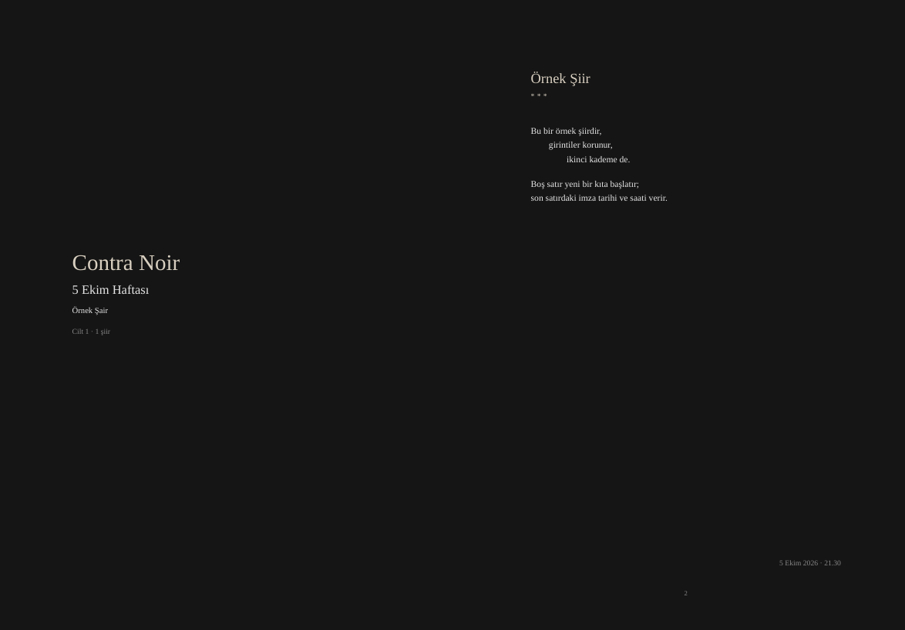

# poet_autopublish

[English](README.md)

Şiirlerini terminalde sakin bir sayfada yaz; kendi serinin (benimkinin adı
*Contra Noir*) haftalık PDF ciltleri olarak otomatik yayımlansın.



- **Yaz**: dikkat dağıtmayan bir yazma ekranı. Satır sarma, daktilo modu,
  otomatik kayıt, taslaklar ve tek tuşla imzalama var.
- **Topla**: şiirler tek bir klasördeki düz metin dosyalarıdır. Son satırdaki
  imza şiirin tarihini ve hangi haftaya ait olduğunu belirler.
- **Yayımla**: her pazartesi–pazar haftası bir PDF cilt olur (kapak, sayfa
  başına bir şiir, künye). Ayrıca içindekiler sayfalı bir toplu kitap çıkar.
  Bir şiir değiştiğinde sadece değişen ciltler otomatik olarak yeniden derlenir.

Programın adı `poetautopublish`, kısa komutu `poet`.

## Kurulum

### Windows

[Releases](https://github.com/D4shwood/poet_autopublish/releases) sayfasından
`poetautopublish-…-windows-setup.exe` dosyasını indirip çalıştır. Yönetici
izni gerekmez. Başlat menüsüne *poetautopublish* ve *Yeni şiir* girdilerini,
komut satırı için `poet` komutunu ve bir kaldırıcı ekler. Kurulum dosyası
imzalı olmadığı için Windows "bilinmeyen yayımcı" uyarısı verebilir:
**Ek bilgi → Yine de çalıştır**'ı seç.

Ya da `…-windows-portable.zip` dosyasını istediğin yere açıp
`poetautopublish.exe`'yi çalıştır.

Yazma, imzalama, koleksiyonlar, yayınlar ve istatistikler Windows'ta çalışır.
PDF'ler için şimdilik XeLaTeX gerekir ([MiKTeX](https://miktex.org) ya da TeX
Live); dahili bir PDF motoru planlanıyor. Arayüz en iyi Windows 11'in
terminalinde görünür.

### Linux

Birkaç yaygın paketle birlikte XeLaTeX gerekir. Arch / CachyOS'ta:

```sh
sudo pacman -S texlive-xetex texlive-latexrecommended texlive-latexextra ttf-liberation
```

**Hazır dosya (Linux x86_64).** [Releases](https://github.com/D4shwood/poet_autopublish/releases)
sayfasından son `.tar.gz` dosyasını indir, sonra:

```sh
tar xzf poetautopublish-*-x86_64-linux.tar.gz
install -Dm755 poetautopublish-*-x86_64-linux/poetautopublish ~/.local/bin/poetautopublish
poetautopublish
```

**Kaynaktan** (Rust gerekir):

```sh
cargo install --git https://github.com/D4shwood/poet_autopublish --root ~/.local
poetautopublish
```

İlk açılışta program seni adım adım tanır:
1. imzalarken kullandığın adın
2. rumuzların
3. şiir klasörü ve PDF klasörü (yoksa oluşturulur)
4. haftalık serinin adı
5. arka planda kendiliğinden derlensin mi

Son adıma evet dersen şunlar kurulur:
- şiir klasörün her değiştiğinde PDF'leri yeniden derleyen bir systemd kullanıcı servisi
- `~/.local/bin` içine `poet` komutu
- *Yeni şiir* eylemli bir menü girdisi

`poetautopublish uninstall` bunların hepsini kaldırır.

Menüdeki **⚙ Ayarlar** aynı ekranları cevapların dolu haliyle tekrar açar.
Kim olduğun, rumuzların, diğer yazarlar ve hafta adların şiir klasörünün
içindeki `.poet/` klasörüne kaydedilir; böylece şiirlerle birlikte başka bir
bilgisayara ya da telefona gider. Klasörler ve bu bilgisayara özel ayarlar
`~/.config/poetautopublish/config.toml` dosyasında kalır; tüm seçenekler için
[config.example.toml](config.example.toml) dosyasına bak.

### Android

[Releases](https://github.com/D4shwood/poet_autopublish/releases) sayfasındaki
en yeni *Poet* sürümünden `Poet-….apk` dosyasını indirip telefonda aç; Android
tarayıcından kurulum yapmaya bir kez izin ister.

Güncellemeleri uygulama mağazası gibi almak için
[Obtainium](https://github.com/ImranR98/Obtainium) kullan: bu reponun adresini
ekle ve *Filter release titles by regular expression* alanına `^Poet` yaz;
böylece masaüstü sürümlerini atlar.

Telefon uygulaması aynı kurallarla şiir yazar, imzalar, listeler ve
bilgisayarın derlediği PDF'leri gösterir. Bilgisayarla, şiirlerinin durduğu
özel bir GitHub reposu üzerinden eşitlenir (bkz. [config.example.toml](config.example.toml)
içindeki *sync*); yalnızca o repoya yetkili bir fine-grained token kullanır.
Kendin derlemek için: [android/README.md](android/README.md).

## Şiir dosyaları

Şiir, uzantısız ya da `.txt` uzantılı bir UTF-8 dosyasıdır:

```
Şiirin başlığı

İlk mısra,
    girintili satırlar girintisini korur,

boş satır yeni bir kıta başlatır.

- Adın Soyadın. 13.10.2026 - 22.58
```

- **1. satır** başlıktır.
- **Son satır imzadır.** Sadece imzalı şiirler yayımlanır.
  `Adın 13/10/2026 22:58` gibi yazımlar ya da saatsiz bir tarih de olur.
- **Günden emin değil misin?** Tarihin önüne `~` koy: `- Adın Soyadın. ~08.10.2026`
  "8 Ekim civarı" demektir. Şiir o haftaya, kesin tarihli şiirlerden sonra
  girer. Alt bilgisinde sadece ayın kaçıncı haftası yazar
  (`Ekim 2026 · 2. hafta`).
- **Rumuzlar ve diğer yazarlar.** Arayüzdeki *İmzalar* ekranı yazarları ve
  rumuzlarını listeler. Kendi adınla ya da rumuzlarından biriyle imzaladığın
  şiirler yayımlanır ve sayfada rumuz görünür. Başka yazarların şiirleri orada
  takip edilir ama yayımlanmaz. Kimseye ait olmayan imzalar da orada çıkar;
  ⏎ ile bir yazara bağlarsın. Tablo şiir klasöründeki
  `.poet/authors.toml` dosyasında tutulur.
- **Tarih bilinmiyorsa:** tarihsiz bir imza da geçerlidir, yeter ki tanınan bir
  ad ya da rumuzla başlasın: `- K.M Ozan Deniz. Mürekkep #2`. Böyle şiirler
  koleksiyonlara ve Yayınlar ağacına girer, haftalık ciltlere giremez, çünkü
  hiçbir haftaya ait değildir.
- **Nerede yayımlandığı:** imza satırında tarihten (ve saatten) sonra yazılan
  her şey yayın bilgisidir, örneğin `- K.M Ozan. 31.10.2024 Mürekkep #0`.
  Tarihin altına *ilk yayın: Mürekkep #0* olarak basılır. Sayıyı `#`'den
  sonra, o baskının özel adını `:`'dan sonra yaz: `Mürekkep #0`,
  `Örnek Yayın #3 : Almanak` ya da `Örnek Yayın : Almanak`. Arayüzde
  **❖ Yayınlar**, her alanın yayımlanmış şiirlerini yayın → sayı → şiir ağacı
  olarak gösterir.
- **Gece yazmak:** 05.00'ten önce imzalanan şiir bir önceki güne sayılır
  (`night_cutoff`), böylece o gecenin haftasında kalır. Sayfada yine gerçek
  saat görünür.
- **Taslaklar:** başlıktan sonraki satıra `#taslak` (ya da `#draft`) yazarsan
  şiir imzalı olsa bile yayımlanmaz.
- **Epigraflar:** adı `_epigraf` ile başlayan bir dosya, bir haftanın kapağına
  alıntı koyar. Son satırı hangi haftaya ait olduğunu belirleyen tarihtir
  (`13.10.2026`).
- **Revizyonlar:** bir şiiri imzaladıktan bir günden fazla sonra düzenlersen
  alt bilgisine `rev. <tarih>` eklenir.

Gizli dosyalar, `_` ile başlayan dosyalar ve yedek dosyaları yok sayılır.

## Koleksiyonlar

Haftalık seriye ait olmayan şiirler, örneğin eski şiirlerin, şiir klasörünün
bir **alt klasörüne** girer (`~/poetry/Eski Şiirler/` gibi). Her alt
klasör kendi kitabı olur: `eski_siirler.pdf`. Kapağında klasörün adı ve senin
adın yer alır; bir de içindekiler sayfası vardır. Şiirler alfabetik sıralanır
ve tıpkı seride olduğu gibi sadece imzalı olanlar yayımlanır. Koleksiyonlar
haftalık ciltlere ve serinin toplu kitabına karışmaz.

Klasörleri elle açman gerekmez. Arayüzde *Koleksiyonlar* başlığı altında boş
olanlar dahil hepsi listelenir. **+ Yeni koleksiyon** ad sorar ve klasörü
kendisi açar. Bir koleksiyon seçiliyken `n`'ye basarsan yeni şiir doğrudan o
koleksiyona yazılır. Koleksiyonun kitabı, içine ilk imzalı şiir girdiğinde
oluşur.

Bir koleksiyonun üstünde ⏎'ye basınca **o koleksiyona girersin**. Başlıkta
koleksiyonun adı yazar ve bütün arayüz ona ait olur: yeni şiirler oraya
kaydedilir; taslaklar, imzasızlar, arama ve istatistikler (haftalar yerine
yıllara göre) sadece o koleksiyonu kapsar. *Diğer alanlar* altındaki
**◆ Contra Noir** seni seriye geri götürür.

## Çıktı

Bir hafta, en erken şiirinin tarihiyle adlandırılır ("5 Ekim Haftası"). Arayüzde
`r` ile yeniden adlandırabilirsin. Özel adlar şiir
klasöründeki `.poet/weeks.toml` dosyasında tutulur. Kapağı, içindekileri
ve PDF başlığını değiştirir, dosya adını değiştirmez.

Yeni haftaları numarayla adlandırmak için `.poet/profile.toml` dosyasına bir
kalıp yaz: `week_format = "{week}. Hafta {yy}'"` *44. Hafta 26'* verir
(`{week}` yılın kaçıncı haftası, `{yy}` / `{yyyy}` yılı). Kendi adı olan
haftalar adını korur.

Her hafta için haftanın ilk şiirinin adını taşıyan bir
`<seri>_GG_AA_week.pdf` dosyası oluşur, örneğin `contra_noir_13_10_week.pdf`.
Toplu kitabın adı `<seri>_all.pdf`'tir ve en yeni hafta en başta yer alır.
`mirror_dir` ayarlarsan her PDF ayrıca başka bir klasöre de kopyalanır (örneğin
eşitlenen bir klasöre).

Şiirlerinin çoğu Türkçeyse PDF etiketleri ve arayüz Türkçe, değilse İngilizce
olur (`lang = "tr" | "en" | "auto"`).

## Kullanım

```sh
poet            # terminal arayüzü
poet new        # doğrudan boş sayfaya
poet build      # değişenleri derle (her şey için --force)
poet watch      # servisin çalıştırdığı komut
```

Arayüzde:

| Tuş | |
|---|---|
| `n` | yeni şiir |
| `r` | seçili haftayı yeniden adlandır (boş bırakırsan varsayılan ad geri gelir) |
| `⏎` | seçili şiiri yazma ekranında aç |
| `/` | tüm şiirlerde ve geçmişlerinde ara |
| `h` | seçili şiirin geçmişi |
| `o` | PDF'i aç (hangi programla açılacağını config'deki `pdf_viewer` belirler) |
| `b` / `f` | derle / her şeyi baştan derle |
| `D` | şiiri çöp kutusuna taşı |
| `s` | istatistikler |
| `w` | arka plan izleyicisini başlat, durdur ya da kur |
| `l` | kayıt |
| `e` | şiiri `$EDITOR` ile aç |
| `q` / **End Noir** | çık; süren bir derleme varsa önce bitmesi beklenir |

Yazma ekranında:
- `Ctrl+S` taslak olarak kaydeder.
- `Ctrl+G` şu anki saatle imzalar ve yayımlar.
- `Ctrl+T` daktilo modunu açıp kapatır.
- `Ctrl+Z` geri alır.
- `Ctrl+E` ölçüyü gösterir (aşağıda).
- `Esc` kaydedip geri döner.

Her kayıt yerel bir geçmişte saklanır
(`~/.local/share/poetautopublish/history`, şiir başına son 50 sürüm).

**Hece ölçüsü ve kafiye.** `Ctrl+E` her mısranın yanında hece sayısını ve
kafiyesini gösterir: `14 a` on dört hece ve *a* kafiye grubu demek; `+r`
rediftir (birkaç mısrayı bitiren aynı kelime); `⚠` ise mısraların çoğunun
tuttuğu ölçüyü bozan mısrayı gösterir. Durum satırında o ölçü yazar
(`hece 7+7 12/14` gibi) ya da şiir serbestse *serbest*. Heceler ünlülerden
sayılır; ölçünün durakları kelime aralarına denk gelmelidir.

**Geçmiş.** `h` ekranında `↑↓` sürüm seçer, `v` seçili sürümü şimdiki metinle
karşılaştırır, `←`/`→` her sürümün neyi değiştirdiğini gösterir, `Space`
şiirin yazılışını sürüm sürüm oynatır: silinen kelimeler üstü çizili,
eklenenler altı çizili. Ayarlarda `variants = true` olursa toplu kitabın
sonuna bir *Varyantlar* bölümü eklenir; düzeltilen her şiir ilk tam
taslağından son hâline gösterilir.

Arka plan servisi çalışmıyorsa, arayüz açık olduğu sürece klasörü kendisi izler.

## Görünümü özelleştirme

[templates/template.tex](templates/template.tex) dosyasını
`~/.config/poetautopublish/template.tex` konumuna kopyalayıp düzenle. Renkler,
fontlar, kenar boşlukları ve kapak düzeni orada. Yeniden derlemeye gerek yok.

Paketteki örnekle denemek için `author = "Örnek Şair"` ayarlayıp şunu çalıştır:

```sh
poet build --poems-dir examples/poems
```

## Yol haritası

Planlanan, henüz yapılmamış özellikler; ayrıntılar [TODO.md](TODO.md) dosyasında.

- **Denemeler**: şiirlerin yanında düzyazı koleksiyonu.
- **Şiiri görsel olarak dışa aktarma**: paylaşmak için tek şiirin PNG sayfası (kare ya da hikâye).
- **Yazma hatırlatıcısı**: birkaç gün şiir yazılmazsa isteğe bağlı bir dürtme.
- **Sayfa önizlemesi**: terminal içinde metin provası (şimdilik askıda).
- **Windows'ta dahili PDF motoru**: TeX kurmaya gerek kalmasın.

## Lisans

Tüm hakları saklıdır.
